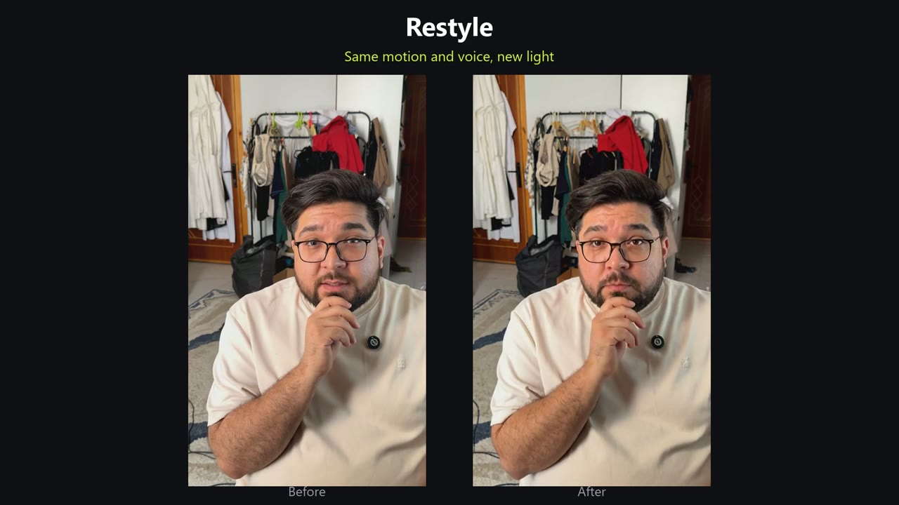

# WanGP Studio

A local, free, Higgsfield-style video studio that runs on one 12 GB GPU. It's a web page on top of
[WanGP](https://github.com/deepbeepmeep/Wan2GP) running the MiniMax H3 models. Type a prompt, drop in references,
and get video with sound. There's no subscription and no per-video cost.

[](docs/demo.mp4)

▶ **[Watch the 50 s demo](docs/demo.mp4)**: every mode, before and after.

Built and measured on an RTX 5070 (12 GB VRAM) with 16 GB RAM.

## What it does

| Tab | What you get | Measured (480p) |
|---|---|---|
| **Image** | Pictures from a prompt plus reference images (Gemini) | – |
| **Create** | Text → video with sound, 2–30 s (a blank line in the prompt starts the next part) | 10 s in 126 s |
| **Restyle** | Your video → the same motion and sound in a new look | 5 s in 149 s |
| **Look** | Swap the person in a clip for a new character (Viggle Remake), ≤ 5.8 s | 5 s in 411 s |
| **References** | Up to 12 files (9 pictures, 3 videos, 3 audio) that hold identity across a clip | 10 s in 503 s |
| **Genjutsu** | Swap or edit things in a clip up to 30 s: one painted keyframe per shot, prompts written per window, 20 styles | 15 s in 1122 s |
| **Mangaka** | A story becomes a manga: cast sheets, pages, speech bubbles (RTL Arabic works). Exports PNG / PDF / CBZ / webtoon | – |

Long clips use WanGP's sliding windows inside one job, so the join between windows isn't visible. A 48 fps switch
(RIFE) is available on every video mode.

## Setup

1. Install [WanGP](https://github.com/deepbeepmeep/Wan2GP) and get MiniMax H3 running there once, so the models download.
2. Put `ffmpeg` and `ffprobe` on your PATH.
3. Install the server packages into WanGP's Python: `fastapi uvicorn python-multipart httpx psutil`.
4. Gemini (used for images, painted keyframes and prompt writing). Choose one:
   - **API:** set `GEMINI_API_KEY`. Optional overrides: `STUDIO_GEMINI_TEXT_MODEL` and `STUDIO_GEMINI_IMAGE_MODEL`.
   - **Your own helper:** set `STUDIO_GEMINI_IMAGE` / `STUDIO_GEMINI_ASK` to node scripts that take
     `"<prompt>" --out file.png [--ref img]...` and `--file prompt.txt [--ref img]...` respectively.
5. If WanGP isn't at `C:\AI\WanGP`, set `WANGP_DIR`.
6. Run `app\start.ps1`, then open http://localhost:4500.

### Low RAM?

H3 needs about 7 GB of free RAM. Copy `mem.example.ps1` to `mem.ps1` and list your heavy background apps in it.
The studio then stops those apps before each job and restarts them afterwards. When free RAM is low, the app
switches WanGP to `--profile 5` by itself.

The server listens on `0.0.0.0` with **no login**. Keep it on your LAN or behind a VPN such as Tailscale.

## Tests

```
<WanGP>\env_uv\Scripts\python.exe -m unittest discover -s app -p "test_*.py"
```

## Contributing

Issues and PRs are welcome. These areas would help most:

- Linux/macOS start scripts (only `start.ps1` exists today)
- A depth-ControlNet mode (it follows hands better than Viggle)
- Look mode beyond 5.8 s by chaining chunks
- More Genjutsu styles and better seam checks
- Translations of the page

## License

MIT. WanGP and the models keep their own licenses.
